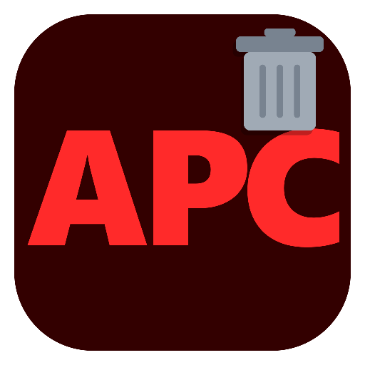

<p align="center">

</p>

# Adobe Process Cleaner (APC)

[Español](#español) | [English](#english)

## Español

Utilidad portátil para cerrar procesos auxiliares de Adobe en Windows.

### Uso

1. Descarga `AdobeProcessCleaner.exe` desde [Releases](https://github.com/Cuby3212/AdobeProcessCleaner/releases/latest).
2. Guarda tu trabajo, cierra las aplicaciones de Adobe y espera a que terminen las instalaciones y la sincronización.
3. Ejecuta el programa. Mostrará los cierres confirmados y los errores.

El lector PDF y `Adobe Installer` quedan fuera de la lista. La herramienta cierra una lista concreta de procesos; no desactiva servicios ni impide que vuelvan a arrancar. Algunos procesos requieren permisos de administrador. No es necesario ejecutarlo como administrador si no aparecen errores de acceso.

Opciones: `--list` muestra los procesos detectados sin cerrarlos; `--no-pause` evita la espera final. Códigos de salida: `0` correcto, `1` cierres sin confirmar, `2` argumentos incorrectos.

El archivo `.bat` es un acceso alternativo y necesita el ejecutable en su misma carpeta.

### Compilar y probar

Windows con .NET Framework 4.x (incluido en Windows 10/11). No necesita PowerShell para ejecutar el programa, SDK adicional ni paquetes externos.

Desde PowerShell, en la carpeta del proyecto:

```powershell
.\build.ps1
.\test.ps1
```

Las pruebas crean y cierran únicamente procesos de prueba. No cierran procesos de Adobe.

### SmartScreen

El ejecutable no está firmado y Windows puede mostrar «Editor desconocido». Descárgalo del repositorio oficial y compara su SHA-256 con el publicado en la release. Ser de código abierto no garantiza por sí solo la seguridad del ejecutable.

## English

Portable utility to close Adobe helper processes on Windows.

1. Download `AdobeProcessCleaner.exe` from [Releases](https://github.com/Cuby3212/AdobeProcessCleaner/releases/latest).
2. Save your work, close Adobe applications, and let installations and synchronization finish.
3. Run the program to see confirmed exits and errors.

The PDF reader and `Adobe Installer` are excluded. A fixed process list is used; services are not disabled and processes may restart. Administrator permissions may be needed for some processes.

Use `--list` to preview without closing anything, or `--no-pause` to skip the final keypress. Exit codes: `0` success, `1` unconfirmed exits, `2` invalid arguments. The optional `.bat` launcher requires the executable in the same folder.

Requires Windows with .NET Framework 4.x (included in Windows 10/11). Run `build.ps1` to compile and `test.ps1` to test. No additional SDK or packages are needed. Tests only close test processes.

The executable is unsigned. Windows may show an unknown publisher warning. Download from this repository and compare the SHA-256 published with the release; open source alone does not guarantee binary safety.

---

Creado por / Created by Cuby3212 · [MIT](LICENSE.md) · [Cambios / Changes](CHANGELOG.md)
