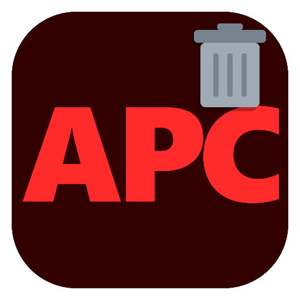

# Adobe Process Cleaner (APC)

🇪🇸 [Español](https://github.com/Cuby3212/AdobeProcessCleaner#-espa%C3%B1ol) | 🇬🇧 [English](https://github.com/Cuby3212/AdobeProcessCleaner#-english)

---

## 🇪🇸 Español

Utilidad ligera para cerrar procesos en segundo plano de Adobe en Windows y liberar recursos del sistema.

### Características principales

* Identifica y detiene todos los procesos y servicios de Adobe (incluida la sincronización en la nube).
* Se ejecuta inmediatamente sin instalación ni configuración.

### Uso

1. Descarga el ejecutable desde [Releases](https://github.com/Cuby3212/AdobeProcessCleaner/releases/latest).
2. Cierra las aplicaciones de Adobe (Photoshop, Premiere, etc.).
3. Ejecuta `AdobeProcessCleaner.exe` y sigue las indicaciones.

### Aviso de SmartScreen

Windows puede mostrar una advertencia de "Editor desconocido" al ser un ejecutable sin firmar. El programa es de código abierto y seguro; para continuar haz clic en **Más información** > **Ejecutar de todas formas**.

### Licencia y autoría

Creado por Cuby3212 bajo la [licencia MIT](LICENSE.md).

---

## 🇬🇧 English

Lightweight utility to close background Adobe processes and free up system resources on Windows.

### Key features

* Identifies and stops all Adobe processes and services (including cloud sync).
* Runs immediately with no installation or setup required.

### Usage

1. Download the executable from [Releases](https://github.com/Cuby3212/AdobeProcessCleaner/releases/latest).
2. Close Adobe applications (Photoshop, Premiere, etc.).
3. Run `AdobeProcessCleaner.exe` and follow the prompts.

### SmartScreen notice

Windows may show an "Unknown Publisher" warning because the executable is unsigned. The tool is open-source and safe; to proceed, click **More info** > **Run anyway**.

### License and author

Created by Cuby3212 under the [MIT license](LICENSE.md).
